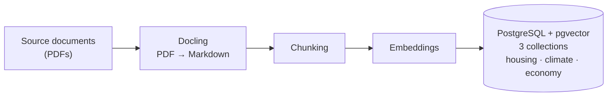
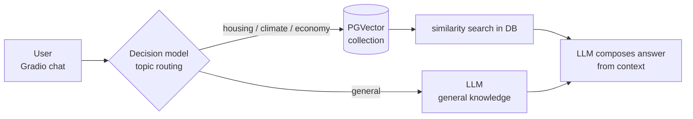

# Routing RAG with decision model

## Description 
Routing experiment: a decision model (e.g Jev) picks which of multiple RAG collections to retrieve from. This repository is an experimental attempt to use a decision model to route RAG retrieval across multiple collections in one PostgreSQL database. Purely technical PoC. For practical use, filtering directly in SQL (metadata / WHERE clauses) is the more realistic approach.

## Architecture

**Build pipeline** (`build_db.py`)

**Query pipeline** (`rag_gui_app.py`)

## Requirements

- Python 3.14
- PostgreSQL with the `pgvector` extension
- Ollama, with the embedding model pulled (It could be replaced with any OpenAI caompatible embeddings, etc)
- An OpenAI-compatible endpoint for the LLM and decision model (Same as embedding model, could be replaced)
- Python packages: `docling`, `langchain-openai`, `langchain-ollama`, `langchain-postgres`, `langchain-text-splitters`, `gradio`, `sqlalchemy`, `psycopg` (see `requirements.txt`)

## Used data

Three StEP (Stadtentwicklungspläne) PDFs, each around 140 pages, mixed text and images, mixed layouts. Downloaded from: https://www.berlin.de/sen/stadtentwicklung/planung/stadtentwicklungsplaene/

- StEP Wohnen 2040
- StEP Wirtschaft 2040
- StEP Klima 2.0

The PDFs are **not** included in this repo. Download them into `data/`.

## Used models for testing

| Role                | Model           |
| ------------------- | --------------- |
| Embedding/Retrieval | F2LLM-V2 (1.7B) |
| LLM (answer)        | Gemma4 E4B      |
| Decision (routing)  | KEV 4B          |

## Notes

- The embedding model at query time **must be identical** to the one used at build time. Switching models requires a full re-ingest.
- `OpenAIDecisions` is a beta class in `langchain-openai`.
- This project is limited to single-turn QA. Each question is classified, retrieved, and answered independently. No chat history is passed to the decision model, the retrieval step, or the LLM. it is only displayed in the chat GUI.

## Screenshots

